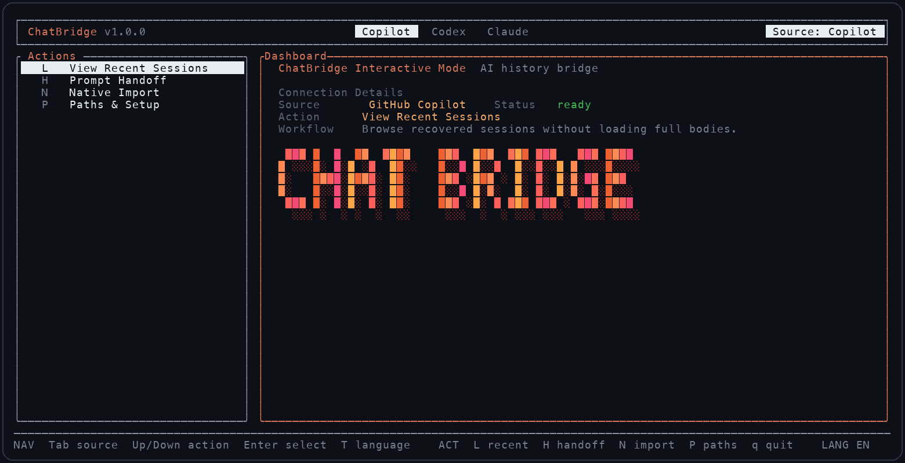

<div align="center">

# ChatBridge

**本地 AI 聊天历史桥接工具，支持 GitHub Copilot、Codex CLI 和 Claude Code。**

[](https://github.com/ylexLiao/chatbridge/actions)
[](https://github.com/ylexLiao/chatbridge/releases)
[](LICENSE)
[](#安装)
[](rust/chatbridge-tui)

[English](README.md) | [中文](README.zh-CN.md)

</div>

ChatBridge 是一个本地 TUI/CLI，用来浏览、交接、修复和原生导入 GitHub Copilot Chat、Codex CLI、Claude Code 的本地聊天历史。

默认情况下它不连接云服务，只读写你机器上的历史文件。执行写入前会自动备份，并尽量写成目标工具自己的历史格式，让导入结果出现在对应工具的 history / resume UI 里。

## 截图



## 亮点

- 浏览 Copilot、Codex、Claude Code 历史，不需要一次加载所有大 transcript。
- 生成 handoff prompt，让另一个 agent 接着做。
- 把会话原生导入到目标工具的本地历史格式，并按目标的上下文窗口控制大小。
- 带上真正干过的活，而不只是聊天：命令和输出、文件改动（diff）、联网和 MCP 调用都会一起迁移。
- 把会话导出为可携带的 JSON 捆绑包，在另一台机器（比如 SSH 远程机）上用命令行或 TUI 导入。
- 导入前先预览会话或捆绑包的内容（几轮对话、多少次工具调用、改过哪些文件）。
- 修复旧导入缺失的索引、缓存、JSONL 文件。
- 诊断 VS Code、Insiders、VSCodium、Cursor、Codex 和 Claude Code 的本地历史路径。
- 把嵌入图片 base64 替换成可读的附件占位说明，避免大段乱码进入聊天记录。

## 安装

要求：Python 3.10 或更新版本。推荐的 release 安装脚本会自带预编译 Rust TUI，所以除非从源码构建，否则不需要 Rust/Cargo。

### 推荐：预编译 Release

macOS / Linux:

```bash
curl --http1.1 -fsSL https://github.com/ylexLiao/chatbridge/releases/latest/download/install.sh | bash
chatbridge
```

Windows PowerShell:

```powershell
irm https://github.com/ylexLiao/chatbridge/releases/latest/download/install.ps1 | iex
chatbridge
```

Release 安装脚本会下载对应平台的预编译 Rust TUI。普通用户不需要 Rust/Cargo。
在 macOS 和 Linux 上，安装脚本会优先把 `chatbridge` 启动器放到当前 `PATH` 中可写的 bin 目录；如果找不到，才回退到 `~/.local/bin` 并打印需要添加的 `PATH` 配置。Windows 安装脚本会在需要时更新当前 PowerShell 会话的 `PATH`，让下一行 `chatbridge` 可以直接运行。

升级已有的 release 安装：

```bash
chatbridge update
chatbridge --version
```

`chatbridge update` 会重新下载对应平台的 release 安装脚本，原地重装 ChatBridge。

当前预编译 release 覆盖 macOS arm64/x64、Linux arm64/x64、Windows x64。Linux release 二进制使用 musl 构建，避免要求目标机器安装较新的 glibc。其他平台可以走源码构建。

| 平台 | 预编译包 | 要求 |
| --- | --- | --- |
| macOS Apple Silicon | `chatbridge-macos-arm64.tar.gz` | Python 3.10+ |
| macOS Intel | `chatbridge-macos-x64.tar.gz` | Python 3.10+ |
| Linux arm64 | `chatbridge-linux-arm64.tar.gz` | Python 3.10+ |
| Linux x64 | `chatbridge-linux-x64.tar.gz` | Python 3.10+ |
| Windows x64 | `chatbridge-windows-x64.zip` | Python 3.10+ |

如果 `releases/latest/download/install.sh` 返回 `404`，说明 GitHub Release assets 还没有发布出来。release workflow 产出 assets 前，可以先用源码安装命令：

```bash
curl --http1.1 -fsSL https://raw.githubusercontent.com/ylexLiao/chatbridge/main/install.sh | bash -s -- --from-source --bootstrap-rust
chatbridge
```

### 通过 npm 从 GitHub 安装

```bash
npm install -g github:ylexLiao/chatbridge
chatbridge
```

这条路径会在 `postinstall` 阶段从源码构建 Rust TUI，所以需要 Cargo。它适合 npm 正式包发布前使用。

### 从源码运行

```bash
git clone https://github.com/ylexLiao/chatbridge.git
cd chatbridge
npm test
npm run build:tui
./bin/chatbridge
```

源码构建需要 Rust/Cargo。

### Homebrew

Homebrew tap 发布后会补上。当前仓库只有 formula 模板：[packaging/homebrew/chatbridge.rb](packaging/homebrew/chatbridge.rb)，还没有发布 `brew install chatbridge` / `brew upgrade chatbridge` 这条安装通道。

## 卸载

macOS / Linux:

```bash
rm -f ~/.local/bin/chatbridge ~/.local/bin/chatbridge-tui
rm -rf ~/.local/share/chatbridge
hash -r 2>/dev/null || true
```

Windows PowerShell:

```powershell
Remove-Item -Force "$HOME\.local\bin\chatbridge.cmd","$HOME\.local\bin\chatbridge.ps1" -ErrorAction SilentlyContinue
Remove-Item -Recurse -Force "$HOME\.local\share\chatbridge" -ErrorAction SilentlyContinue
```

这些命令会删除 `chatbridge` 启动器和 ChatBridge 安装包。它会保留 `~/.chatbridge/config.json`，也不会删除 Copilot、Codex、Claude Code 或 VS Code 的历史文件。
如果安装时用了自定义 `--prefix` 或 `--dir`，删除对应的 `bin/chatbridge` 启动器和安装目录即可。

也可以让安装脚本删除默认安装：

```bash
curl --http1.1 -fsSL https://github.com/ylexLiao/chatbridge/releases/latest/download/install.sh | bash -s -- --uninstall
```

重新安装并快速验证：

```bash
curl --http1.1 -fsSL https://github.com/ylexLiao/chatbridge/releases/latest/download/install.sh | bash
chatbridge paths doctor
```

## 快速开始

```bash
chatbridge paths doctor
chatbridge list --source copilot --limit 5
chatbridge list --source codex --limit 5
chatbridge list --source claude --limit 5
```

生成 handoff prompt：

```bash
chatbridge handoff --from copilot --to codex --last
```

原生导入到另一个工具：

```bash
chatbridge native-import --from codex --to claude --session <session-id> --apply
chatbridge native-import --from claude --to copilot --session <session-id> --project /path/to/repo --apply
```

`native-import` 默认是 dry-run，只有加 `--apply` 才会写入。导入默认落在会话自己的项目路径（来源历史里记录的 project），和当前目录无关；用 `--project` 可以改写目标项目。dry-run 会打印一行 `Target project:`，方便先确认目的地。

把会话导出成可携带捆绑包，再在别处导入：

```bash
chatbridge export --from copilot --session <session-id>
chatbridge native-import --bundle chatbridge-export-copilot-<session-id>.json --to claude --apply
```

查看会话或捆绑包里有什么，以及本机能找到哪些捆绑包：

```bash
chatbridge preview --from codex --session <session-id>
chatbridge preview --bundle chatbridge-export-codex-<session-id>.json
chatbridge bundles
```

## TUI

不带参数运行 `chatbridge`。`Tab` 切换来源工具，操作如下：

| 按键 | 操作 |
| --- | --- |
| `L` | 查看最近会话；`Enter` 显示对话轮数、工具调用和改过的文件 |
| `H` | 为另一个 Agent 生成接续提示 |
| `N` | 原生导入到另一个工具，或选 `Export bundle (.json)` 导出 |
| `I` | 导入 JSON 捆绑包（自动列出 `~/.chatbridge/exports/`、当前目录、`~/Downloads` 和 `~` 里的捆绑包，也可以手动输入路径） |
| `P` | 路径诊断与设置 |

真正写入前会先显示预览，再到确认页选择 `预演` / `执行`；在确认页按 `E` 可以改成导入到别的项目（另一台机器导出的捆绑包，项目路径在本机往往不存在）。结果页里 `PgUp`/`PgDn` 翻页，`C` 通过 OSC 52 复制到剪贴板（tmux 需要 `set -g set-clipboard on`）。TUI 会跟随系统语言（`zh_*` 显示中文），`T` 切换语言，`CHATBRIDGE_LANG=en|zh` 可以强制指定。

## 支持范围

| 工具 | 读取 | 原生导入 | 本地状态 |
| --- | --- | --- | --- |
| GitHub Copilot Chat | 支持 | 支持 | VS Code `workspaceStorage`、`chatSessions`、聊天索引、Agent Sessions cache |
| Codex CLI | 支持 | 支持 | `~/.codex/state_5.sqlite`、rollout JSONL、session/history 索引 |
| Claude Code | 支持 | 支持 | `~/.claude/history.jsonl`、project transcript JSONL |

## 路径配置

在 TUI 里按 `P` 可以打开路径设置表单。选择要设置的目标路径，输入目录后按 `Enter` 保存。在表单里按 `Ctrl+D` 可以运行和 `chatbridge paths doctor` 一样的诊断（原来的 `?` 快捷键现在会往路径输入框里输入 `?` 字符）。

```bash
chatbridge paths doctor
chatbridge paths set --copilot-workspace-storage /path/to/workspaceStorage
chatbridge paths set --codex-home /path/to/.codex
chatbridge paths set --claude-home /path/to/.claude
chatbridge paths edit
```

配置文件位置：`~/.chatbridge/config.json`。

也支持环境变量：

```bash
CHATBRIDGE_COPILOT_WORKSPACE_STORAGE=/path/to/workspaceStorage
CHATBRIDGE_CODEX_HOME=/path/to/.codex
CHATBRIDGE_CLAUDE_HOME=/path/to/.claude
CHATBRIDGE_API_TIMEOUT=120
```

`CHATBRIDGE_API_TIMEOUT` 控制 TUI 调用后端命令的超时秒数（默认 120）。加载过程中也可以按 `Esc` 提前取消。

## 原生导入安全说明

ChatBridge 会尽量写成目标工具自己的历史格式，而不是只塞一条纯文本摘要。

- Codex：写 rollout JSONL，并更新 `state_5.sqlite`、`session_index.jsonl`、`history.jsonl`。会话会标记成 `~/.codex/config.toml` 里配置的 model provider（`model_provider`，或当前 `profile` 里的；默认 `openai`），因为 Codex 只列出和恢复当前 provider 的会话。除非 `config.toml` 里指定了模型，否则不写死模型，恢复时由 Codex 使用当前默认模型。
- Claude Code：写带 `parentUuid` 链接的 project transcript，并更新 `history.jsonl`。
- GitHub Copilot：写 VS Code `chatSessions/*.jsonl` 和 `.json`，并更新 `chat.ChatSessionStore.index` 与 Agent Sessions cache。

工具调用会以代码块的形式写进助手回复（例如 `[Tool: shell] $ npm test` 加上输出），方便阅读。很长的会话会按大致的 token 预算裁剪，保证目标工具还能恢复：先缩短较早的工具输出，再省略较早的工具调用，再缩短较早的长消息，对话本身尽量完整保留。预算跟随 `--level`（`brief` 约 2 万、`normal` 约 6 万、`full` 约 12 万 tokens；TUI 用 `full`）。预演和导入都会写明裁掉了什么。用 `--max-tokens N` 指定预算，`--max-tokens 0` 表示全部导入。

导入 Copilot 前请完全退出所有 VS Code 窗口。VS Code 会把聊天索引缓存在内存里，退出时可能覆盖离线写入。

修复旧导入：

```bash
chatbridge repair-codex-imports --apply
chatbridge repair-claude-imports --apply
chatbridge repair-copilot-imports --apply
```

### Codex 兼容性

导入已在 Codex 0.137 到 0.164 上验证。ChatBridge 1.0.x 导入到 Codex 时把 provider 写成了 `codex`，除非你的 `config.toml` 里定义了 `[model_providers.codex]`，否则 Codex 不认识它：`codex resume` 里看不到这些会话，强行恢复会报 ``Model provider `codex` not found``。运行一次 `chatbridge repair-codex-imports --apply` 就会改成当前 provider（导入的每一轮对话都会保留）。

Codex 0.153 起换了新的（paginated）会话文件格式；ChatBridge 两种格式都能读，包括命令、补丁和它们的输出。列表里范围显示为 `PROMPTS` 的会话只剩 `history.jsonl` 里的提问记录（完整对话文件已经没了，或在另一个 Codex 目录里），导出时也只有这些提问。

## 导出捆绑包与远程机器

`chatbridge export` 会把一个会话写成可携带的 JSON 捆绑包（`"format": "chatbridge-bundle"`、`"version": 1`）：

```bash
chatbridge export --from copilot --session <session-id>
# -> ./chatbridge-export-copilot-<session-id>.json （用 --out PATH 改输出位置）
```

捆绑包包含会话元数据（来源、标题、项目路径、时间戳）、`stats` 统计，以及按顺序排列的消息，其中包括工具调用（`"role": "tool"`，带命令或 diff 和输出）和工件。写入前会先脱敏并把嵌入的 base64 图片替换成占位说明，所以这个文件可以放心在机器之间传输。特别长的工具输出会截断（保留开头和结尾）；每个文件的 diff 最多保留 2 万字符。1.0.x 导出的捆绑包仍然可以导入。

在 TUI 里，每个来源的目标选择界面都有 `Export bundle (.json)` 选项，文件写到 `~/.chatbridge/exports/`（不再写到当前目录，当前目录经常是 git 仓库）。在另一台机器上，把文件放进 `~/.chatbridge/exports/`、`~/Downloads`、`~` 或启动 `chatbridge` 的目录，然后按 `I` 导入。

想在远程机器（Remote SSH 等）上继续本地会话：

```bash
# 1. 本地机器：导出会话
chatbridge export --from copilot --session <session-id>

# 2. 把捆绑包拷贝到远程机器
scp chatbridge-export-copilot-<session-id>.json remote:

# 3. 远程机器：原生导入捆绑包（远程不需要有源历史）
chatbridge native-import --bundle chatbridge-export-copilot-<session-id>.json --to codex --apply
chatbridge native-import --bundle chatbridge-export-copilot-<session-id>.json --to claude --apply
# ……或者在那台机器上运行 `chatbridge` 按 I
```

如果捆绑包里的项目是 `vscode-remote://` URI，导入到 Codex 或 Claude Code 时会自动翻译成远程文件系统路径（比如 `vscode-remote://ssh-remote%2Bbox/home/ubuntu/app` 变成 `/home/ubuntu/app`）。用 `--project` 可以改写目标项目。

## Copilot 本地和远程工作区

Copilot Chat 历史保存在本机 VS Code 用户数据目录里，即使项目是通过 Remote SSH、Dev Containers、WSL 或其他 `vscode-remote://` URI 打开的。

远程项目导入时，ChatBridge 仍然写本机 VS Code 的 `workspaceStorage`。workspace id 是 remote URI 的 MD5，`workspace.json` 会保留远程 folder URI：

```text
workspaceStorage/md5("vscode-remote://...")/workspace.json
workspaceStorage/md5("vscode-remote://...")/chatSessions/<session-id>.jsonl
workspaceStorage/md5("vscode-remote://...")/chatSessions/<session-id>.json
```

所以 Copilot remote import 写入的是拥有这个 remote workspace 历史的本机 VS Code profile，不是远程服务器文件系统。

## 嵌入图片

有些来源会把图片存成巨大的 `data:image/...;base64,...` 文本。ChatBridge 不会把它伪装成原生附件，因为通常已经没有可靠的原始附件文件或引用。它会替换成简短说明：

```text
[Image attachment not imported: embedded PNG data URL, approx 820.0 KB]
```

## 开发

```bash
npm test
npm run test:rust
npm run build:tui
npm pack --dry-run
```

用真实的 Codex 验证导入（临时 `CODEX_HOME`，不调用模型，不碰 `~/.codex`）：

```bash
python3 scripts/codex_compat_check.py --codex-bin "$(which codex)"
npm install --prefix /tmp/codex-0.137 @openai/codex@0.137.0
python3 scripts/codex_compat_check.py --codex-bin /tmp/codex-0.137/node_modules/.bin/codex
CHATBRIDGE_CODEX_BIN="$(which codex)" npm test   # 作为单元测试运行同样的检查
```

## 致谢

感谢LINUXDO提供的帮助：https://linux.do

## 许可证

MIT
